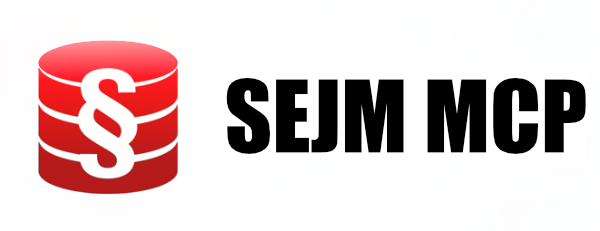

# Parliament of Poland MCP Server

An MCP server for the Polish Parliament public API: the [Sejm API](https://api.sejm.gov.pl/sejm.html) (MPs, votings, legislative processes, ...) and the [ELI API](https://api.sejm.gov.pl/eli.html) of legal acts published in Dziennik Ustaw and Monitor Polski.

## Usage

This server is designed to be run with `npx`, allowing you to use it as a tool provider for LLM clients without a global installation.

### Running with `npx`

To start the server, run the following command:

```bash
npx parliament-poland-mcp-server
```

### Configuration for LLM Clients

To integrate this server with an LLM client (like LM Studio or others that support MCP), you can configure it to spawn the server process. Here is an example configuration:

```json
{
  "mcpServers": {
    "parliament-poland-mcp-server": {
      "command": "npx",
      "args": [
        "-y",
        "parliament-poland-mcp-server"
      ]
    }
  }
}
```

This configuration tells the client how to start the tool server.

## Server Functions

The server provides the following functions:

### Bilateral Groups

- [ ] `getBilateralGroupsTool`: Get a list of bilateral groups for a given term.

### Clubs

- [ ] `getClubsTool`: Get a list of clubs for a given term.
- [ ] `getClubTool`: Get detailed information about a specific club.

### Committees

- [ ] `getCommitteesTool`: Get a list of committees for a given term.
- [ ] `getCommitteeTool`: Get detailed information about a specific committee.
- [ ] `getCommitteeSittingsTool`: Get a list of sittings of a committee, optionally within a date range.
- [ ] `getCommitteeSittingTool`: Get details about a single committee sitting, including its agenda and videos.

### Interpellations

- [ ] `getInterpellationsTool`: Get a list of interpellations for a given term.
- [ ] `getInterpellationTool`: Get detailed information about a specific interpellation.
- [ ] `getInterpellationTextTool`: Get the text of an interpellation or of a reply to it.

### MPs

- [ ] `getMpTool`: Get information about a member of Parliament.
- [ ] `getMpsTool`: Get a list of MPs for a given term.
- [ ] `getMpVotingStatsTool`: Get voting attendance statistics of an MP for each sitting day.
- [ ] `getMpVotingsTool`: Get how an MP voted on a given sitting day.

### Prints

- [ ] `getPrintsTool`: Get a list of prints for a given term.
- [ ] `getPrintTool`: Get detailed information about a specific print.

### Proceedings

- [ ] `getProceedingsTool`: Get a list of proceedings for a given term.
- [ ] `getCurrentProceedingTool`: Get the current or next sitting of the Sejm with its agenda.

### Legal Acts (ELI)

Acts are identified by their [ELI](https://eur-lex.europa.eu/eli-register/about.html): publisher (`DU` for Dziennik Ustaw, `MP` for Monitor Polski), year and position, e.g. `DU/2024/1`. The `ELI` field of a legislative process from `getProcessTool` or `getPassedProcessesTool` links the bill passed by the Sejm to the act as published, and the `prints` of an act link back to the process.

- [ ] `searchActsTool`: Search legal acts by title, publisher, year, type, keywords, status (in force) and dates of signing, publication or entry into force.
- [ ] `getActTool`: Get details of a legal act: status, dates, keywords, issuing authority and references to other acts (amending acts, consolidated texts, implementing acts, ...). Long reference lists are summarized per type; `referenceType` lists all references of one type.
- [ ] `getActTextTool`: Get the text of a legal act as plain text, either a single article (e.g. `415` or `18^3a`) or the whole act in pages of 20,000 characters by default (codes are over 400,000 characters long; use `offset` to continue). Acts published only as a PDF return a link to the PDF. The text is the act as published: the current wording of an amended act is in its newest consolidated text (`Inf. o tekście jednolitym` in the references from `getActTool`).
- [ ] `getActKeywordsTool`: List the keywords used to classify acts, optionally filtered, for use in `searchActsTool`.

### Legislative Process

- [ ] `getProcessTool`: Get information about a specific legislative process (identified by its print number, e.g. `1070` or `16168-z`).
- [ ] `getProcessesTool`: Get a list of legislative processes for a given term.
- [ ] `getPassedProcessesTool`: Get a list of passed legislative processes for a given term.

### Terms

- [ ] `getTermsTool`: Get a list of Sejm terms.

### Transcripts

- [ ] `getTranscriptsTool`: Get the list of transcript statements for a Sejm sitting day.
- [ ] `getStatementTool`: Get the text of a single statement from a sitting transcript.

### Videos

- [ ] `getVideosTool`: Get a list of video recordings for a given term.
- [ ] `getVideosByDateTool`: Get video transmissions from a given day (today by default).

### Votings

- [ ] `getVotingsTool`: Get a list of votings for a given term.
- [ ] `getVotingTool`: Get the results of a single voting with a breakdown by club, and optionally how each MP voted.
- [ ] `searchVotingsTool`: Search for votings by title, sitting or date range.

### Written Questions

- [ ] `getWrittenQuestionsTool`: Get a list of written questions for a given term.

## Development

To run the server in a development environment:

1.  Clone the repository.
2.  Install dependencies: `npm install`
3.  Run unit tests: `npm test`
4.  Run live API integration tests (requires internet access): `npm run test:live-api`
5.  Build the project: `npm run build`
6.  Run the server: `npm start`

## Author

Piotr Kolawa ([@pkolawa](https://github.com/pkolawa)) / ([Linkedin](https://linkedin.com/in/pkolawa))

## License

This project is licensed under the MIT License - see the [LICENSE](LICENSE) file for details.
